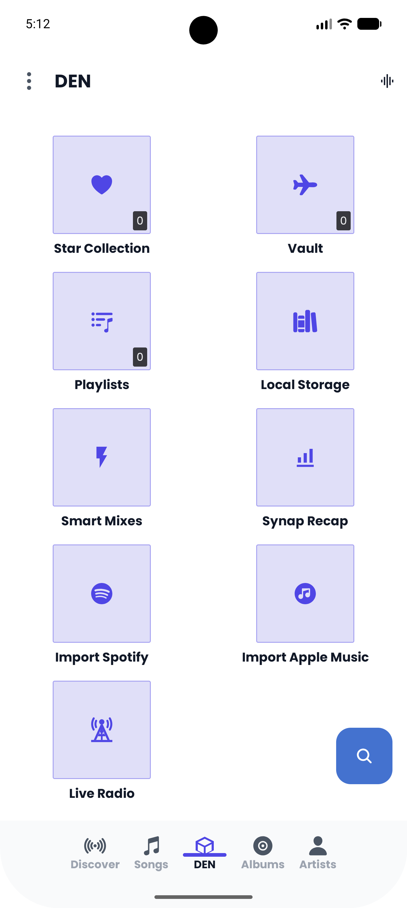
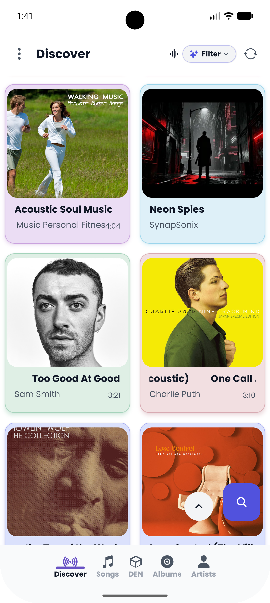
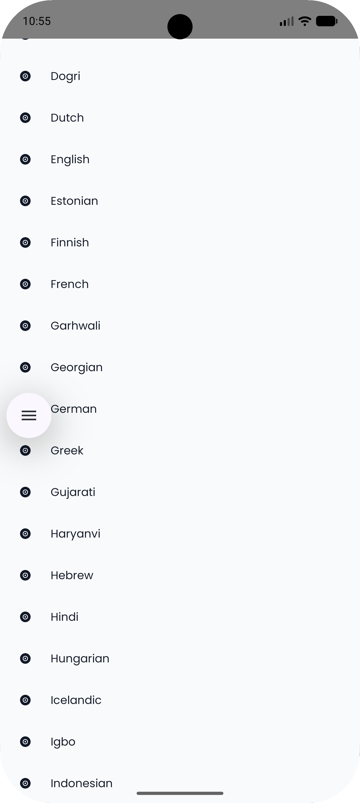
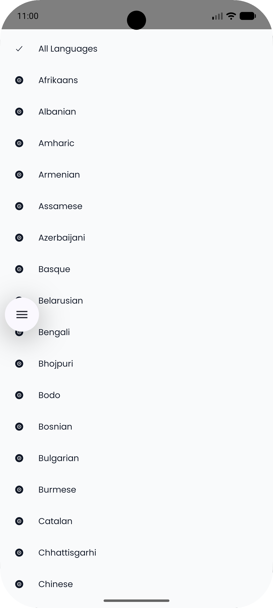
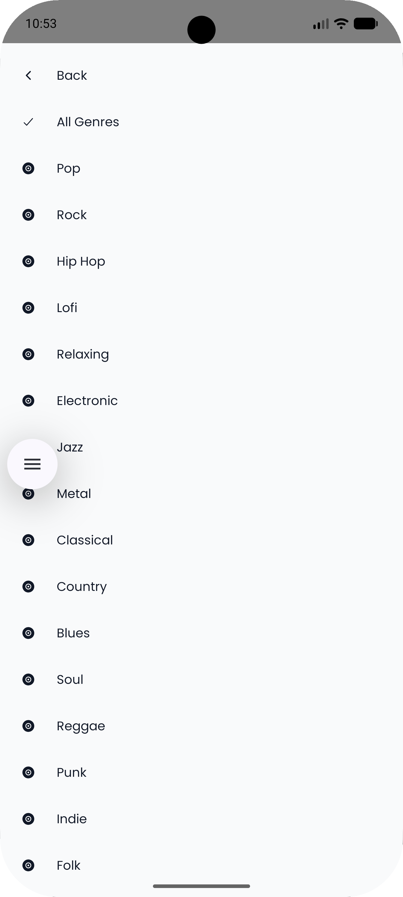
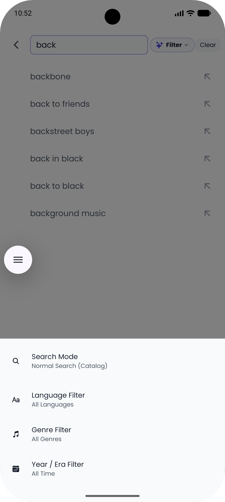
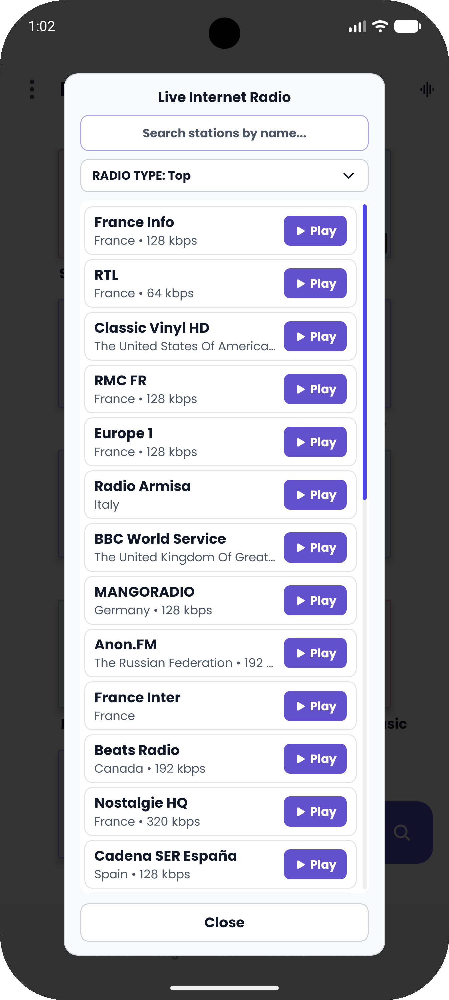

  
  <h1>🎶 SynapMusic</h1>
  
<b>An open-source Android music player for offline storage & YouTube Music streaming.</b>

  
SynapMusic combines local music playback, YouTube Music streaming, offline Vault downloads, custom audio DSP, real-time lyrics translation, WebDAV cloud drives, and instant library backups—with individual settings to turn off any feature you don't need.

  

    
    
    
    
  

  

    <a href="#-features">✨ Features</a> •
    <a href="#-privacy--principles-non-features">🔒 Privacy</a> •
    <a href="#-adaptive-codec-selection">⚡ Codecs</a> •
    <a href="#-tech-stack">🛠️ Tech Stack</a> •
    <a href="#-legal-disclaimer">⚖️ Legal</a>
  

---

## ✨ Features

### 🎶 Full-Screen Gesture Player
Full-screen gesture player bottom sheet featuring dynamic album artwork recoloring, playback controls, and queue drawer.

  
  &nbsp;&nbsp;&nbsp;&nbsp;
  

---

### 🎨 Dynamic Album Cover Palette Extraction
Theme engine extracts HSL swatches directly from the currently playing track's artwork (`Palette.from(bitmap)`), mathematically calculating primary accent, dark vibrant secondary, and light vibrant background tints across the UI.

  
  &nbsp;&nbsp;&nbsp;&nbsp;
  

---

### 🎨 Appearance & Typography Settings
* **Color Themes**: Select from Dynamic Album Art (recolors the UI using current cover art), Dark, Pure Black AMOLED, Light, or custom color presets (Nord, Dracula, Catppuccin, Tokyo Night, Emerald Forest, Cyberpunk, Sunset OLED).
* **Pulsating Color Effects**: Animated color transitions with customizable speed (Chill, Natural, Energetic) and intensity (Gentle, Balanced, Vibrant). Can be enabled or disabled separately for action buttons, DEN tiles, and Discover cards.
* **Fonts**: Default `Poppins` font, with options to switch to your device's native system font and toggle font padding.
* **Thumbnail Roundness**: Set image corner roundness across lists and grids to None, Light, Medium, or Heavy.
* **System Bars**: Automatic status bar and navigation bar icon color matching.

  
  &nbsp;&nbsp;&nbsp;&nbsp;
  
  &nbsp;&nbsp;&nbsp;&nbsp;
  

---

### 🦁 The DEN Lair & Storage Scanner
Personal audio fortress tab featuring custom Playlists, Local Storage, Smart Mixes, Synap Recap, Live Radio, and Import Portals.

  
  &nbsp;&nbsp;&nbsp;&nbsp;
  

---

### ⭐ Star Collection & Offline Vault
Access your liked tracks and offline Vault downloads with support for both 2-column **Grid View** and high-density **List View**.

  

---

### 💿 Studio Albums & Artist Discographies
Browse studio tracklists, official album pages, and complete artist discographies.

  
  &nbsp;&nbsp;&nbsp;&nbsp;
  

---

### 🏷️ ID3 Audio Tag & Cover Art Editor
Edit track title, artist name, album title, and select custom album cover artwork from your phone's photo gallery with real-time Coil image cache eviction.

  

---

### 📦 SynapCube Backups (.synapcube)
Export and restore multiple playlists, tracks, or your entire library as portable `.synapcube` archives compressed with Zstandard JNI and protected by XOR stream obfuscation.

  

---

### 🧹 Memory, Cache & Database Settings
Granular controls for Coil image cache size, song/lyrics cache eviction, and Vault database healing/optimization in **Settings -> Memory Settings**.

  

---

### 🎛️ Equalizer, Mastering & Audio DSP
In-app 5-band interactive frequency sliders, hardware Bass Boost (0–100%), 3D Surround Virtualizer (0–100%), Loudness Target, Headphone Crossfeed, and Immersive Decoding.

  
  &nbsp;&nbsp;&nbsp;&nbsp;
  

---

### 🔍 Discover Feed & Filters
Dynamic Discover feed with granular filters for Language, Genre, Decade, and Exclude AI Songs toggle.

  
  &nbsp;&nbsp;&nbsp;&nbsp;
  

---

### 🌐 Language Discovery Filters
Filter discovery feed by regional languages (Hindi, English, Japanese, Spanish, Korean, Tamil, Telugu, etc.).

  
  &nbsp;&nbsp;&nbsp;&nbsp;
  

---

### 🎵 Genre & Year Discovery Filters
Filter discovery feed by music genres, release decade, or year.

  
  &nbsp;&nbsp;&nbsp;&nbsp;
  

---

### 🔎 Interactive Search Bar & Modes
In-header editable search bar for modifying terms on-the-fly, dynamic Language query suffix resolution, and search modes.

  
  &nbsp;&nbsp;&nbsp;&nbsp;
  

---

### 🎵 Song & Album Search Results
Tabbed search results with instant preview for songs, studio albums, and singles.

  
  &nbsp;&nbsp;&nbsp;&nbsp;
  

---

### 👤 Artist Search & Discography Navigation
Search artist profiles, browse full discographies, or navigate directly to artist pages.

  
  &nbsp;&nbsp;&nbsp;&nbsp;
  
  &nbsp;&nbsp;&nbsp;&nbsp;
  

---

### 📻 Live Internet Radio Browser
Search and stream tens of thousands of live global FM/AM and online web radio stations via RadioBrowser API.

  

---

### 🎤 Real-Time Karaoke Lyrics Engine
Multi-provider synced lyrics (LRCLIB, SkyLyrics, YouTube Captions) featuring spring animations, accent glow, tap-to-seek, and Google Auto-Translation into 15 languages.

  
  &nbsp;&nbsp;&nbsp;&nbsp;
  

---

### 🎙️ Music Recognition ("Shazam" Mode)
Identify real-world ambient music playing around you using AudD and automatically match & play it on YouTube Music.

  

---

### ⚙️ Feature Visibility Switches
Enable or disable feature tiles (*Local Storage*, *Smart Mixes*, *Synap Recap*, *Spotify Import*, *Apple Music Import*, *Live Radio*, *WebDAV*) in **Settings -> Other Settings**.

  
  &nbsp;&nbsp;&nbsp;&nbsp;
  

---

### 🌐 Integrations & System Reset Settings
Manage Shazam/AudD music recognition, WebDAV NAS storage, Discord Rich Presence, Android Auto, search history, and factory settings reset.

  
  &nbsp;&nbsp;&nbsp;&nbsp;
  

---

### 🚫 SponsorBlock Segment Skipping
Integrates SponsorBlock (`https://sponsor.ajay.app`) to automatically skip non-music chatter (`music_offtopic`), video intros, outros, sponsorships, and subscribe reminders.

---

## 🔒 Privacy & Principles (Non-Features)

* 🔒 **No Google Login**: No account or sign-in needed.
* 🛡️ **No Tracking / Ads**: Zero telemetry or ads.
* 💚 **No Subscriptions**: 100% free and open-source.

---

## ⚡ Adaptive Codec Selection

The `CompressionManager` selects the codec based on your device status:

| Priority | Trigger | Codec Choice |
| :--- | :--- | :--- |
| **Endurance** | Battery < 15% | **Opus** *(Fastest zero-transcode download & 85% data/storage saving)* |
| **Efficiency** | Storage < 8GB | **Opus** / **AAC** *(Minimal file size footprint)* |
| **Performance** | High-End Hardware & Charging | **SAC** / **L3AC** / **SQZ** *(Audiophile WavPack / Lossless)* |
| **Streaming** | Mobile Data | **Opus** *(Extreme bandwidth efficiency)* |

### Integrated Formats & Performance Matrix

| Format | Compression | Quality | Storage Saving | Battery Usage |
| :--- | :---: | :---: | :---: | :---: |
| **Opus** (`.opus`) | Lossy | High (92k–510k) | Extreme | Excellent |
| **AAC** (`.m4a`) | Lossy | Standard (192k–256k) | High | Excellent |
| **FLAC** (`.flac`) | Lossless | Perfect Bit-Exact | Moderate | Best |
| **WavPack** (`.wv` / `.mkv`) | Lossless / Hybrid | Perfect Bit-Exact | High | Good |
| **L3AC** (`.mkv`) | Lossless Hi-Res | Audiophile (24-bit/48kHz) | High | Good |
| **SAC** (`.mkv`) | Lossless Super Audio | Audiophile (24-bit/48kHz) | High | Good |
| **SLAC** (`.mkv`) | Lossless Super Lite | Perfect Bit-Exact | High | Good |
| **SQZ** (`.mkv`) | Lossless Compressed | Perfect Bit-Exact | High | Good |

---

## 📦 Build Variants & APK Optimization

* **Original Unsplit Footprint**: `136 MB`
* **Optimized Release Size**: **`29 MB`** (ARM64 Split, ~79% footprint reduction)

### Available Download Variants (GitHub Releases)

| File Name | Purpose | Recommended For | Size | ABIs |
| :--- | :--- | :--- | :---: | :--- |
| **`SynapMusic-app-arm64-v8a-release.apk`** | Modern Android Phones | Most Modern Devices | `29 MB` | `arm64-v8a` |
| **`SynapMusic-app-armeabi-v7a-release.apk`** | Older Phones / Android TVs | Legacy Devices & TVs | `27 MB` | `armeabi-v7a` |
| **`SynapMusic-app-x86_64-release.apk`** | Intel Chromebooks & Emulators | 64-bit Intel Devices | `30 MB` | `x86_64` |
| **`SynapMusic-app-x86-release.apk`** | 32-bit Intel Emulators | Legacy Intel Devices | `29 MB` | `x86` |
| **`SynapMusic-app-universal-release.apk`** | Single File for All Devices | Universal Sideloading | `89 MB` | All 4 ABIs |

> **Note**: Download pre-built APKs directly from the [**GitHub Releases Page**](https://github.com/amarachan/SynapMusic/releases).

---

## 🛠️ Tech Stack

* **UI**: Jetpack Compose (Poppins typography, dynamic album artwork HSL palette extraction).
* **Audio Engine**: AndroidX Media3 ExoPlayer with native Android `AudioEffect` DSP (`Equalizer`, `BassBoost`, `Virtualizer`, `LoudnessEnhancer`, `DynamicsProcessingManager`).
* **C/C++ Native Processing**: FFmpeg binaries and yt-dlp stream extraction (16 KB page-aligned for Android 15+).
* **Database**: Room DB (`Database.kt`) storing tracks, albums, artists, playlists, and listening stats.
* **Networking**: Ktor HTTP client (`ktor-client-okhttp`) with Brotli decompression.
* **Image Pipeline**: Coil WebP pipeline with 512MB disk cache.
* **APIs**: SponsorBlock, LRCLIB, SkyLyrics, Google Translate, MusicBrainz, TheAudioDB, AudD, RadioBrowser.
* **Background Jobs**: WorkManager (`OptimizationWorker` & `MaintenanceHealer`) for daily library optimization and Vault healing.

---

## 📥 Download & Installation

1. Go to the [**GitHub Releases Page**](https://github.com/amarachan/SynapMusic/releases).
2. Download the latest `.apk` file (Choose **`SynapMusic-app-arm64-v8a-release.apk`** for modern phones, or **`SynapMusic-app-universal-release.apk`** if unsure).
3. Enable "Install from Unknown Sources" on your Android device if prompted.
4. Install and enjoy!

---

## 🤝 Contributing

We welcome contributions! If you want to fix bugs or add features, check out our [**Contributing Guidelines**](CONTRIBUTING.md).

---

## ⚖️ Legal Disclaimer

### 🚫 Non-Affiliation
SynapMusic is **NOT** affiliated with or endorsed by **Google LLC**, **YouTube**, or **YouTube Music**.

### 🏷️ Trademarks
"YouTube" and "YouTube Music" are registered trademarks of Google LLC, used here solely for descriptive purposes.

### ⚖️ Fair Use
Provided for educational and personal use under fair use principles. Does not circumvent DRM.

**SynapMusic** is licensed under the [GNU General Public License v3.0](LICENSE).

Copyright © 2026 SynapMusic Maintainers & amarachan (ACVG)
